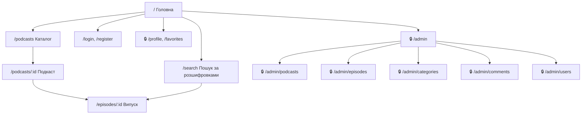
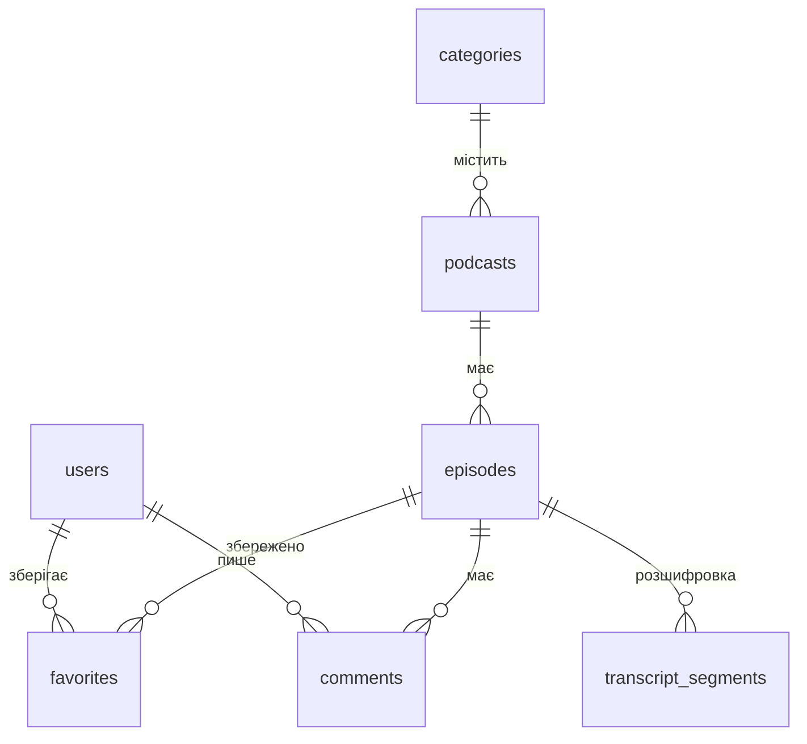

# Технічне завдання наскрізного проєкту «Хвиля»

Автор: Хорошилова Анна, група 5-ІПБ
Дисципліна: «Вебтехнології та вебдизайн», практична робота № 2

## 1. Тема проєкту

**Назва застосунку:** «Хвиля».

**Призначення:** вебзастосунок-каталог україномовних подкастів, у якому кожен випуск можна прослухати у вбудованому плеєрі й прочитати його текстову розшифровку з таймкодами, а пошук працює не лише за назвою, а й за тим, що говорять у випуску.

**Цільова аудиторія:** студенти та молоді фахівці 17–30 років, які слухають освітні й науково-популярні подкасти в дорозі та під час навчання і хочуть швидко знаходити в довгому випуску потрібний фрагмент.

### Перевірка теми за критеріями допуску

| Критерій | Як виконується у «Хвилі» |
|---|---|
| Дані зберігаються в базі даних | MySQL: користувачі, категорії, подкасти, випуски, фрагменти розшифровки, вибране, коментарі |
| Є реєстрація та щонайменше дві ролі | Реєстрація за email; ролі «слухач» і «адміністратор» (плюс незареєстрований гість) |
| Є ≥ 2 пов'язані сутності, крім користувачів | categories → podcasts → episodes → transcript_segments |
| Дані можна створювати, читати, редагувати, видаляти | Адміністратор — CRUD подкастів, випусків, категорій; слухач — CRUD власних коментарів і вибраного |

## 2. Ролі користувачів

| Роль | Мета використання | Що доступно |
|---|---|---|
| Гість | Ознайомитися з каталогом і знайти потрібний випуск без реєстрації | Головна, каталог, фільтр за категорією, пошук за назвою та за текстом розшифровки, сторінки подкасту й випуску, прослуховування, читання коментарів, реєстрація та вхід |
| Слухач (зареєстрований користувач) | Зберігати цікаві випуски й обговорювати їх | Усе, що гостю, а також вибране, коментарі (створення, редагування й видалення власних), профіль |
| Адміністратор | Наповнювати каталог і підтримувати порядок | Усе, що слухачу, а також адмінпанель: CRUD подкастів, випусків із розшифровкою, категорій; модерація коментарів; блокування користувачів |

## 3. Функційні вимоги

| № | Вимога | Роль | Пріоритет |
|---|---|---|---|
| 1 | Гість може переглянути каталог подкастів, де для кожного показано обкладинку, назву, автора, категорію та кількість випусків | Гість | обов'язкова |
| 2 | Гість може відфільтрувати каталог за однією категорією | Гість | обов'язкова |
| 3 | Гість може знайти подкаст або випуск за частиною назви | Гість | обов'язкова |
| 4 | Гість може знайти випуски за словом чи фразою з тексту розшифровки й побачити знайдений фрагмент із таймкодом | Гість | обов'язкова |
| 5 | Гість може відкрити сторінку випуску, прослухати аудіо у вбудованому плеєрі та прочитати розшифровку | Гість | обов'язкова |
| 6 | Гість може натиснути на фрагмент розшифровки, і плеєр почне відтворення з цього таймкоду | Гість | бажана |
| 7 | Гість може зареєструватися (ім'я, email, пароль) і увійти до системи | Гість | обов'язкова |
| 8 | Слухач може додати випуск у вибране, видалити його звідти й переглянути список вибраного | Слухач | обов'язкова |
| 9 | Слухач може залишити коментар до випуску, відредагувати й видалити власний коментар | Слухач | обов'язкова |
| 10 | Слухач може змінити ім'я та аватар у профілі | Слухач | бажана |
| 11 | Адміністратор може створити, відредагувати й видалити подкаст | Адміністратор | обов'язкова |
| 12 | Адміністратор може додати до подкасту випуск з аудіофайлом і розшифровкою, відредагувати й видалити його | Адміністратор | обов'язкова |
| 13 | Адміністратор може створити, перейменувати й видалити категорію; категорію, до якої належать подкасти, видалити не можна | Адміністратор | обов'язкова |
| 14 | Адміністратор може приховати будь-який коментар | Адміністратор | бажана |
| 15 | Адміністратор може заблокувати слухача, після чого той не може увійти | Адміністратор | бажана |

## 4. Нефункційні вимоги

| Категорія | Вимога |
|---|---|
| Продуктивність | Сторінка каталогу (20 подкастів) відкривається не довше ніж за 2 с; пошук за розшифровками в базі до 1000 випусків повертає результат не довше ніж за 1 с |
| Безпека | Паролі зберігаються лише як хеш (`password_hash`); маршрути слухача без входу перенаправляють на `/login`, маршрути `/admin/*` для не-адміністратора повертають 403; усі запити до БД виконуються як підготовлені (PDO) |
| Адаптивність | Інтерфейс коректно відображається за ширини вікна від 360 до 1920 px без горизонтальної прокрутки; кнопки плеєра мають розмір не менше 44 × 44 px |

## 5. Карта сайту

| Розділ / сторінка | Маршрут | Доступ | Захищений |
|---|---|---|---|
| Головна (нові випуски, категорії) | `/` | гість, слухач, адміністратор | ні |
| Каталог подкастів (фільтр, пошук за назвою) | `/podcasts` | гість, слухач, адміністратор | ні |
| Сторінка подкасту (опис, список випусків) | `/podcasts/:id` | гість, слухач, адміністратор | ні |
| Сторінка випуску (плеєр, розшифровка, коментарі) | `/episodes/:id` | гість, слухач, адміністратор | ні |
| Пошук за розшифровками | `/search?q=` | гість, слухач, адміністратор | ні |
| Вхід / реєстрація | `/login`, `/register` | гість | ні |
| Профіль | `/profile` | слухач, адміністратор | так |
| Вибране | `/favorites` | слухач, адміністратор | так |
| Адмінпанель (зведення) | `/admin` | адміністратор | так |
| Керування подкастами | `/admin/podcasts`, `/admin/podcasts/new`, `/admin/podcasts/:id/edit` | адміністратор | так |
| Керування випусками й розшифровками | `/admin/podcasts/:id/episodes`, `/admin/episodes/new`, `/admin/episodes/:id/edit` | адміністратор | так |
| Керування категоріями | `/admin/categories` | адміністратор | так |
| Модерація коментарів | `/admin/comments` | адміністратор | так |
| Користувачі | `/admin/users` | адміністратор | так |
| Сторінка 404 | `*` | усі | ні |

## 6. Користувацькі сценарії

**Сценарій гостя** — знайти фрагмент про стипендію: гість відкриває головну → вводить у поле пошуку «стипендія» → бачить список випусків, у розшифровці яких є це слово, з фрагментом тексту й таймкодом → відкриває випуск → натискає на фрагмент, і плеєр починає відтворення з 12:40 → натискає «У вибране» → система пропонує увійти → гість реєструється й повертається на сторінку випуску.

**Сценарій слухача** — зберегти й обговорити випуск: слухач входить до системи → відкриває каталог і обирає категорію «Освіта» → відкриває подкаст і потрібний випуск → слухає його та читає розшифровку → додає випуск у вибране → пише коментар із запитанням до автора → згодом відкриває «Вибране», вмикає випуск ще раз і видаляє його зі списку після прослуховування.

## 7. Ескіз структури бази даних

| Сутність | Основні атрибути | Первинний ключ |
|---|---|---|
| users | name, email (унікальний), password_hash, role (user / admin), avatar, is_blocked, created_at | id |
| categories | name (унікальна), slug | id |
| podcasts | category_id, title, author_name, description, cover, created_at | id |
| episodes | podcast_id, title, description, audio_url, duration_sec, published_at | id |
| transcript_segments | episode_id, start_sec, text | id |
| favorites | user_id, episode_id, created_at | (user_id, episode_id) |
| comments | episode_id, user_id, body, is_hidden, created_at, updated_at | id |

| Зв'язок | Тип | Де зовнішній ключ |
|---|---|---|
| categories → podcasts | один до багатьох | `podcasts.category_id` |
| podcasts → episodes | один до багатьох | `episodes.podcast_id` |
| episodes → transcript_segments | один до багатьох | `transcript_segments.episode_id` |
| users ↔ episodes (вибране) | багато до багатьох | зв'язувальна таблиця `favorites` (`user_id`, `episode_id`) |
| users → comments | один до багатьох | `comments.user_id` |
| episodes → comments | один до багатьох | `comments.episode_id` |

Схема: `docs/db-schema.png`, вихідний код для dbdiagram.io — `docs/db-schema.dbml`.

## 8. Обґрунтування стеку

| Рівень | Технологія | Чому доречна саме тут |
|---|---|---|
| Клієнтська частина | React | Плеєр має грати безперервно, поки слухач переходить між каталогом, пошуком і сторінками випусків, тому потрібен односторінковий застосунок без перезавантаження сторінок; розшифровка, яка підсвічує поточний фрагмент, — це стан, що змінюється щосекунди, і React перемальовує лише потрібний рядок |
| Стилі | SCSS + БЕМ | Однакові картки подкастів і випусків повторюються на головній, у каталозі, пошуку й вибраному; БЕМ дає їм незалежні назви класів, а змінні й міксини SCSS тримають в одному місці кольори та точки адаптивності 360 / 768 / 1280 px |
| Серверна частина | PHP | Потрібні реєстрація з хешуванням паролів, сесії, перевірка ролей і приймання аудіофайлів від адміністратора; PHP має це вбудованим (`password_hash`, `$_SESSION`, `$_FILES`) і вже працює в мене в XAMPP з ПР1 |
| База даних | MySQL | Дані «Хвилі» чітко пов'язані (категорія → подкаст → випуск → фрагменти), тому потрібна реляційна БД із зовнішніми ключами; повнотекстовий індекс MySQL (`FULLTEXT`) дозволяє шукати слово в тисячах фрагментів розшифровки |
| Розміщення | вебхостинг | Звичайний хостинг із PHP і MySQL дешевший за хмарний сервер і достатній для навчального проєкту; статичну збірку React можна покласти в ту саму теку, а аудіофайли — у каталог завантажень |
